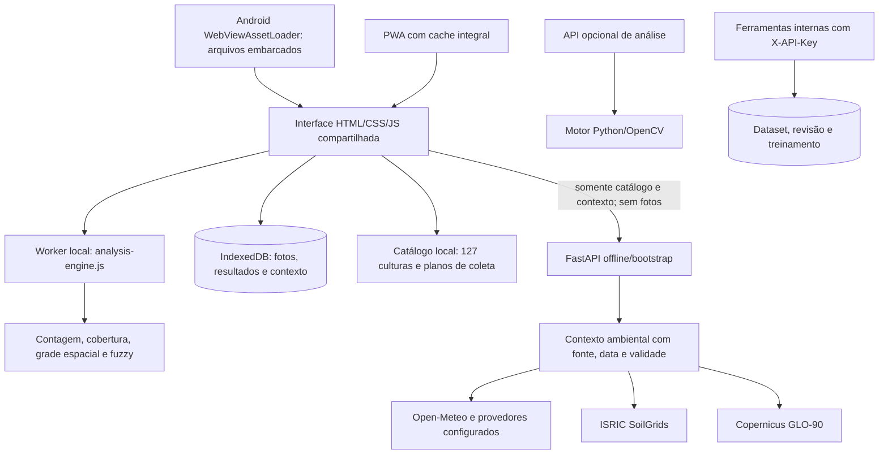

# Contexto técnico atual do SIOPA

Atualizado em **20/10/2026** após a reestruturação para análise local e uso offline.
O levantamento anterior está preservado em
[archive/PROJECT_CONTEXT_INITIAL_2026-10-20.md](archive/PROJECT_CONTEXT_INITIAL_2026-10-20.md).
O código é a fonte de verdade. Este documento registra implementação e limites,
sem declarar precisão científica ainda não medida.

## Objetivo e contexto

TCC de ensino médio técnico da ETEC Rodrigues de Abreu, já apresentado. O usuário
pretende continuar o desenvolvimento por pelo menos o próximo ano. A nova direção
é um aplicativo Android que fotografa papel hidrossensível/microporoso, conta manchas
isoladas resolvíveis, exclui manchas unidas/minúsculas/bordas da contagem e calcula
avaliação fuzzy. Deve trabalhar sem rede e sincronizar fontes ambientais quando houver
conexão. O usuário confirmou Android primeiro e papel amarelo que marca azul. Foram
indicados 76 × 26 e 76 × 25 mm, sem escolha de marca/modelo. 76 × 26 mm é somente
valor inicial editável, sem confirmação automática; não há fator universal de espalhamento.

Autoria e direitos continuam em `AUTHORS.md`, `LICENSE.md` e `NOTICE.md`.

## Arquitetura atual

O APK contém UI, motor e catálogo e pode abrir sem conexão desde a instalação.
Na PWA é necessário concluir o primeiro cache com HTTPS/localhost e rede. Fotos e
resultados permanecem no IndexedDB; o fluxo principal não faz upload de imagens.
Não há servidor público fixo embutido no APK: a atualização usa endereço HTTPS
configurado pelo usuário. Chaves pagas ficam no servidor, nunca no APK.

O deploy EC2 é opcional e desativado sem a variável de repositório
`ENABLE_EC2_DEPLOY=true`. Quando habilitado, exige CI aprovado para o SHA exato
de `main`, secrets completos e host key SSH fixada. O push e o CI independem de
EC2; nenhuma hospedagem é criada por esse controle. Operação e diagnóstico:
[GITHUB_ACTIONS_SECRETS.md](GITHUB_ACTIONS_SECRETS.md).

## Responsabilidades e contratos

| Grupo | Responsabilidade |
| --- | --- |
| `app/static/analysis-engine.js` | Motor portátil, sem rede/dependências: `SiopaAnalysis.analyzeImageData(ImageData, options)` e `evaluateQuality`. |
| `app/models/image_analysis.py` | Implementação Python/OpenCV equivalente nos cenários cobertos; `process_image(path, options=None)`. Sem carregar banco ou joblib. |
| `app/services/spray_quality.py` | Fuzzy Sugeno com perfil, pertinências, regras, evidências e status explícitos. |
| `app/static/app.js`, `index.html`, `app.css` | Câmera/galeria, cantos, calibração, culturas/perfil, overlay, histórico, contexto e exportação. |
| `analysis-worker.js` | Executa o cálculo fora da thread da interface; fallback local existe na UI. |
| `offline-store.js` | IndexedDB: `samples` e `metadata`; fotos não entram em fila de sincronização. |
| `service-worker.js` | Cache versionado do conjunto completo de assets; não intercepta APIs nem uploads. |
| `mobile/android` | Aplicativo Java/Android, AndroidX WebViewAssetLoader, câmera, GPS e exportação nativa. |
| `app/data/crops.json` | Fonte canônica do catálogo, aliases, estágios genéricos, fontes e planos editoriais. |
| `app/static/crops.json` | Cópia embarcada; atualizar com `scripts/sync_crop_catalog.py`; teste compara os arquivos. |
| `crop_catalog.py` | Busca normalizada, catálogo e metadata/perfis sem inventar limiares por cultura. |
| `weather_service.py` | Open-Meteo atual/previsão, fallbacks, cache atômico e indisponibilidade sem mocks. |
| `environmental_service.py` | Solo/elevação e composição do contexto, resolução, períodos, incerteza e validade. |
| `agriculture_service.py` | Cultura e contexto sem presumir solo, pH, bioma ou receituário. |
| `recommendation_service.py` | Orientações de deposição/cultura; não infere pragas, produto ou dose pela foto. |
| `agrofit_service.py` | Busca/cache oficial de catálogo; campo ausente não satisfaz filtro explícito. |
| `routes_new.py` | Bootstrap, contexto, análise opcional no servidor, culturas, clima, preview e diagnóstico. |
| `dataset_routes.py`, `models/database.py` | Dataset privado, anotações/revisão, modelos, sessões e exportação. |
| `core/access.py` | Desativa ferramentas internas por padrão; exige flag e chave em header. |
| `ml_training.py`, `vision_features.py` | Pesquisa com classificadores de recortes; separado do motor portátil operacional. |

As declarações e rotas estão em [FUNCTION_INDEX.md](FUNCTION_INDEX.md).

## Medição e fuzzy

1. Orientação EXIF aplicada pelo decoder; papel amarelo detectado ou quatro cantos
   fornecidos pelo usuário. Retificação respeita o lado maior e não amplia para criar
   resolução artificial. Análise limitada a 2.400 px; prévia mobile até 3.000 px.
2. Grandezas físicas exigem tamanho do papel confirmado ou escala manual explícita.
   Detectar um retângulo não confirma sua dimensão física.
3. Manchas azuis/roxas são segmentadas e classificadas por componente/geometria.
   `total_droplets`/`valid_droplets` contam somente manchas isoladas aceitas.
   Coalescências, bordas e manchas abaixo do piso ficam fora dessa contagem.
4. Cobertura é área de pixels segmentados na região interior analisada, sem expansão
   artificial. Densidade usa a mesma área física interior; não extrapola para o talhão.
5. `cv_coefficient` é agora CV espacial de contagens por células. A dispersão dos
   diâmetros fica em `diameter_cv_coefficient`. Não confundir as grandezas.
6. `dv50_diameter` é `null`. `dv50_proxy_um` é somente proxy cúbico das manchas,
   sem fator de espalhamento para recuperar o diâmetro original das gotas.
7. Piso inicial de mancha: 0,10 mm, configurável. O resultado informa também
   `effective_min_stain_diameter_mm`, limitado pela resolução e pixels por componente.
8. Fuzzy retorna evidências, pertinências, regras e perfil. Sem escala válida o score
   é `null`; perfil experimental gera `provisional`, confirmado gera `indicative`.
   Nenhum desses estados significa eficácia biológica ou precisão da contagem.

O perfil inicial é uma triagem de engenharia configurável, não uma norma universal
agronômica. A identidade da cultura não define sozinha metas de deposição. Detalhes,
fórmulas e fontes: [IMAGE_METHOD.md](IMAGE_METHOD.md). Para validação por humanos:
[VALIDATION_PROTOCOL.md](VALIDATION_PROTOCOL.md) e `scripts/evaluate_counts.py`.

## Dados externos e sincronização

`GET /api/v1/offline/bootstrap` retorna `schema_version`, `generated_at`,
`catalog_version`, `engine_version`, `crops`, `quality_profiles`, `environment`,
`paper_defaults` e `capabilities`. GPS é opcional; sem coordenadas não consulta fontes.
Com permissão de GPS e conexão, a UI pré-carrega contexto e guarda o snapshot.

Contexto: `weather.current/forecast/hourly`, `soil`, `terrain`, `provenance`,
`coordinates`, `availability`, `fetched_at`, `expires_at` e `stale`. Datas da consulta
não substituem data de observação/modelo. Cache não renova silenciosamente o dado
antigo quando uma consulta falha. Clima e solo/relevo têm TTLs separados; validade
agregada é a menor. Falta de fonte mantém campos nulos e motivo explícito.

- Open-Meteo: modelo de tempo, sem chave no protótipo não comercial; endpoint/chave
  configuráveis para serviço pago. Não equivale a medir vento na altura do bico.
- SoilGrids: previsões de propriedades em grade de 250 m e profundidades indicadas,
  com intervalos disponíveis; não é análise laboratorial do solo local.
- Copernicus GLO-90: elevação regional de superfície em 90 m; declividade permanece
  nula, pois uma consulta de um ponto não a determina.

Fontes, licenças, estado de disponibilidade e smoke real realizado estão em
[DATA_SOURCES.md](DATA_SOURCES.md). Comprar uma API não garante exatidão do talhão;
medições locais podem ser necessárias para esse objetivo.

## Dataset, treinamento e segurança

Ferramentas internas exigem `ENABLE_DATASET_API=True` e `ADMIN_API_KEY` forte.
O cliente envia `X-API-Key`. Anotador guarda a chave somente em memória; CLIs aceitam
`SIOPA_ADMIN_API_KEY` ou `--api-key`. Nenhuma chave é embarcada no APK.

Upload do dataset normaliza EXIF para pixels RGB/PNG sem metadados, mantendo dimensões
e coordenadas consistentes. Validação ocorre antes de substituir anotações; falhas
não apagam o conjunto existente. Escala positiva pode ser atualizada na mesma transação.
Salvar marca revisão pendente; somente todas as anotações aprovadas tornam a imagem
validada para treinamento. O anotador oferece revisão individual ou do conjunto.

Treino usa apenas imagens validadas e anotações aprovadas. Recortes de uma mesma
imagem e de arquivos binariamente idênticos ficam juntos no holdout por hash.
Validação e teste são combinados e essa limitação aparece nos metadados; não é um
benchmark independente final. Progresso artificial com sleeps foi removido. Modelos
não viram prontos para produção/ativos automaticamente por accuracy de recortes.
O treinamento **não modifica o motor de medição offline** nesta versão.

Tabelas ORM continuam: `ImageDataset`, `ImageAnnotation`, `ApplicationCondition`,
`AnalysisResult`, `MLModel`, `TrainingSession`, `DatasetSplit`, `AnnotationTask`.
O fluxo operacional mobile guarda histórico no dispositivo, sem inserir esses
registros no servidor. `app.db`, imagens, modelos e `.env` existentes foram preservados.

## Verificações e operação

- Suíte Python isolada cobre visão/fuzzy, paridade real JS/Python, catálogo/cache,
  APIs offline, recomendação, dataset/revisão/EXIF e divisão de treino.
- CI executa a suíte completa e verifica sintaxe JavaScript; dados reais não são
  usados pelos testes. `tests/conftest.py` isola ambiente, caminhos e credenciais.
- Há teste real de navegador sem rede para Worker, histórico IndexedDB e reload.
- Android tem Gradle Wrapper, scripts de build e assets compartilhados. Build debug
  e lint devem ser conferidos no relatório de entrega; não equivalem a teste de câmera
  e GPS em aparelho físico.
- `Dockerfile` usa healthcheck da porta configurada; Compose fixa porta interna 8000.
  Estatísticas públicas são do processo atual e não inventam precisão histórica.

Guias: [MOBILE_OFFLINE.md](MOBILE_OFFLINE.md), [API_DOCUMENTATION.md](API_DOCUMENTATION.md),
[DEPLOYMENT.md](DEPLOYMENT.md), [DEPLOYMENT_EC2.md](DEPLOYMENT_EC2.md).

Ainda será necessário validar a contagem com fotos reais de celulares, papel e
protocolo confirmados, calibrar perfis com avaliação agronômica e testar aparelhos
físicos. A base de 127 culturas é informativa com planos genéricos, não uma coleção
de receituários ou parâmetros quantitativos validados para cada espécie.
