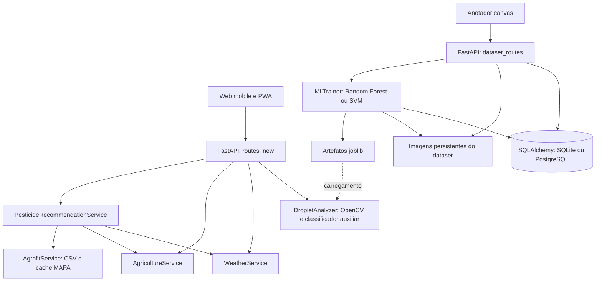

# Contexto técnico do SIOPA

Levantamento inicial: **20/10/2026**, a partir dos arquivos presentes no workspace,
incluindo alterações ainda não commitadas. Documento para continuidade técnica;
não representa certificação científica, execução de testes ou inspeção do servidor
publicado. Confirme o fonte antes de implementar mudanças.

## Projeto e intenção

SIOPA significa Sistema Inteligente de Otimização da Pulverização Agrícola.
É um TCC de ensino médio técnico da ETEC Rodrigues de Abreu, já apresentado pelo
usuário. A intenção informada é continuar grandes avanços e desenvolvimentos por
pelo menos o próximo ano. Não foi definido nesta conversa um conjunto de novas
funcionalidades ou um cronograma de entregas.

Os quatro autores acadêmicos estão registrados em `AUTHORS.md`; Gustavo Teodoro
Fantini é o contato operacional do repositório. `LICENSE.md` e `NOTICE.md` descrevem
o estado de direitos adotado pelo próprio projeto. Preserve esses registros.

## Escopo e método da leitura

- Foram lidos integralmente os **74 arquivos de texto** do código, testes,
  documentação, infraestrutura e configuração versionável: aproximadamente
  **12.866 linhas** antes da criação destes documentos.
- Foram inventariados **104 arquivos** ao excluir internos do Git, caches e bytecode.
  A diferença corresponde a três configurações privadas, um banco, um log,
  vinte imagens e cinco modelos serializados.
- Configurações privadas foram examinadas com valores redigidos; logs, por
  contagens e período. Nenhuma credencial é necessária a este mapa.
- O SQLite existente foi aberto explicitamente em modo somente leitura para
  verificar esquema e contagens, sem inicializar a aplicação.
- As vinte imagens foram comparadas por SHA-256; os seis conteúdos distintos
  foram inspecionados visualmente. Modelos serializados foram inventariados,
  **sem desserialização ou validação de compatibilidade**.
- Não foram executados servidor, instalação, treino, demonstração, upload,
  migração, deploy ou chamadas a provedores. O `python` encontrado no PATH era
  um alias WindowsApps inacessível; os testes não foram executados.
- Não foram tratados como fonte do projeto os objetos de `.git`, caches e `.pyc`.

## Arquitetura e responsabilidades



| Arquivo ou grupo | Responsabilidade |
| --- | --- |
| `main.py` | Factory FastAPI, lifespan, middleware, estáticos, roteadores, handlers e health/readiness. |
| `start.py` | CLI Uvicorn: host, porta, workers, reload, URLs e abertura opcional do navegador. |
| `app/api/routes_new.py` | Análise integrada, clima, agricultura, solo, AGROFIT, configuração pública e diagnóstico. |
| `app/api/dataset_routes.py` | Upload persistente, imagens/anotações/revisão, modelos, treinamento, estatísticas e exportação. |
| `app/core/config.py` | Pydantic Settings, leitura de ambiente, normalização, caminhos e calibração física. |
| `app/core/database.py` | Engine/sessões, criação/migração/seed, transações, estatísticas, backup e reset. |
| `app/core/runtime.py` | Relatório de configuração e avisos; `ready` exige chave não padrão e caminhos existentes. |
| `app/core/exceptions.py` | Exceções de domínio e handlers JSON. |
| `app/models/database.py` | Oito modelos ORM e helpers para dataset, anotações e desempenho. |
| `app/models/image_analysis.py` | Detecção do papel, perspectiva, segmentação, candidatos, métricas e qualidade. |
| `app/services/vision_features.py` | Extração compartilhada das 18 features de recortes para treino/inferência. |
| `app/services/ml_training.py` | Classificadores de recortes RF/SVM, threads de treino, avaliação e artefatos. |
| `app/services/weather_service.py` | Clima/previsão de provedores, consolidação, regras de adequação e fallback sintético. |
| `app/services/agriculture_service.py` | Culturas/estágios, contexto municipal/regional, solo estimado e Agromonitoring. |
| `app/services/agrofit_service.py` | Descoberta CKAN, download/cache CSV e busca de produtos formulados. |
| `app/services/recommendation_service.py` | Catálogo fixo, pressões heurísticas, modelos sintéticos, dose/horário e complemento AGROFIT. |
| `app/utils/logger.py` | Loguru: console, arquivo com rotação/retenção e helpers de contexto. |
| `app/static/index.html`, `app.css`, `app.js` | Jornada principal de análise em HTML/CSS/JS puro. |
| `app/static/annotation.html` | Interface independente de anotação, com CSS e JS embutidos. |
| `service-worker.js`, `manifest.webmanifest`, `icon.svg` | Shell PWA, instalação e identidade visual. |
| Arquivos `__init__.py` | Marcadores/docstrings dos pacotes; `app/__init__.py` declara versão 1.0.0, divergente de Settings 2.0.0. |

O índice atual de declarações e rotas está em [FUNCTION_INDEX.md](../FUNCTION_INDEX.md).

## Jornadas e contratos principais

### Análise operacional

1. A interface carrega `/api/v1/client/config` e o guia da cultura selecionada.
2. O usuário envia foto, latitude, longitude, cultura, estágio opcional e alvo opcional.
3. `POST /api/v1/analyze-image` valida coordenadas e upload, cria arquivo temporário,
   processa a foto, consulta clima/cultura e solicita recomendação.
4. Retorna JSON com `analysis`, `weather`, `agriculture`, `recommendations`, metadata
   e mensagem; a imagem temporária é excluída.
5. A interface monta métricas, decisão visual, contexto regional e recomendação.

Esse fluxo **não salva histórico em `AnalysisResult` nem incorpora automaticamente
a foto ao dataset**. O alvo informado vai para metadata, mas não é passado ao
motor de recomendação. Clima/cultura são consultados tanto pela rota quanto pelo
recomendador. `POST /api/v1/test-analysis` oferece somente a análise da imagem.

### Dataset e anotação

O upload do dataset salva arquivo e metadados persistentes. O anotador lista imagens,
desenha círculos de gotas pequenas/médias/grandes, duplicadas e sujeira, ajusta raio
por cor, oferece zoom/movimento/seleção e envia autoria, confiança e diâmetros
derivados da escala. O upload envia a escala física da imagem; salvar anotações
não atualiza diretamente essa escala no registro da imagem.
Salvar **substitui todo o conjunto de anotações da imagem**, sem versionamento.

As rotas permitem revisar uma anotação, porém a UI atual não oferece essa etapa.
Novas anotações começam `pending`. O treino usa imagens marcadas como anotadas e
suas anotações sem exigir aprovação; o exportador usa apenas `approved`.
Assim, um conjunto recém salvo pode treinar e produzir COCO sem anotações.
`is_validated` existe, mas não há fluxo atual que o mantenha atualizado.

### Treinamento

Há dois contratos: JSON em `/api/v1/ml/train`, usado pelo CLI, e formulário em
`/api/v1/training/start`. Modelos e sessões têm listagem/cadastro próprios. O trabalho
roda em thread daemon no processo da aplicação, com estado também no banco.
Não há fila de tarefas persistente independente dos workers.

## Visão computacional e definição das métricas

`DropletAnalyzer.process_image` executa leitura, preprocessamento, segmentação e
quantificação. O pipeline de segmentação é **OpenCV**. O modelo sklearn opcional
ajuda a filtrar candidatos; não substitui a segmentação por uma rede neural.

- Detecta região amarela/laranja por HSV/LAB, morfologia, contornos e geometria.
- Retifica perspectiva com quatro pontos para a proporção configurada do papel.
- Papel padrão: **76 × 26 mm**; aresta de análise: **1.200 px**; margem: **2%**.
- Com papel detectado, calcula mm/px pela largura física; sem papel, usa escala
  configurada `PIXEL_TO_MM=0.1`, ajustada pelo redimensionamento.
- Aplica CLAHE/sharpening e combina sinais de azul/escuro, LAB e morfologia.
- Classifica contornos por raio, aspecto, solidez, circularidade, lóbulos,
  contato com borda e eventual probabilidade do classificador auxiliar.
- Raios físicos aceitos por padrão: **0,03–1,25 mm**.
- Mantém válidas, duplas, bordas, ruído e rejeições por tamanho separados.

| Campo | O que o código calcula na leitura inicial |
| --- | --- |
| `total_droplets`, `valid_droplets` | Mesmo número de candidatos classificados como válidos. |
| `double_droplets`, `duplicated_droplets` | Mesmo número de candidatos classificados como duplos. |
| Impactos estimados | Válidas + estimativa de lóbulos das duplas; não é separação individual das gotas. |
| Cobertura | Estimativa ampliada: usa círculos com raio 2×, máximo entre áreas segmentada/circular/soma teórica, fator `DROPLET_COVERAGE_SCALE=1.3` e limite de 100%. |
| Densidade | Gotas válidas / área física total em cm². |
| CV | Desvio padrão populacional dos diâmetros / média × 100. |
| Campo chamado DV50 | `np.median` dos diâmetros; não há ponderação por volume. |
| Diâmetro | Diâmetro circular equivalente da mancha, em µm; não há conversão explícita de espalhamento para a gota original. |
| Qualidade | Escore heurístico por cobertura, CV e densidade, com penalidades de duplas/borda/calibração. |

As fórmulas centrais ficam em `image_analysis.py:423–487`; a qualidade em
`:763–828`. Antes de tratar esses resultados como medidas científicas, será
necessário definir protocolo, grandezas e validação. A retificação de papel
vertical merece teste específico, pois ordenação de cantos e largura de destino
não verificam explicitamente a orientação física do lado longo.

## Aprendizado de visão: features, classes e artefatos

O `MLTrainer` extrai recortes das anotações e negativos aleatórios fora das marcas,
treina RF ou SVM e salva classificador/metadados com joblib. RF usa 100 árvores e
balanceamento de classes; SVM usa scaler e kernel RBF. Accuracy e precision/recall/F1
com média ponderada são calculados em um split aleatório de recortes.

Classes: `0 background`, `1 droplet_small`, `2 droplet_medium`, `3 droplet_large`,
`4 droplet_duplicate`, `5 dirt`. Anotações legadas são interpretadas por tipo,
sobreposição, classe, diâmetro físico ou raio, em ordem de prioridade.

As **18 features** compartilhadas são:

```text
gray_mean, gray_std, laplacian_var, sobel_x_mean, sobel_y_mean,
lab_l_mean, lab_a_mean, lab_b_mean, hsv_h_mean, hsv_s_mean, hsv_v_mean,
foreground_area, aspect_ratio, solidity, perimeter, circularity,
bbox_fill_ratio, center_background_delta
```

Pontos de continuidade: separar treino/teste por imagem/coleta, controlar duplicatas,
registrar conjuntos e versões, conferir compatibilidade de modelos antigos e medir
o pipeline final. Hoje recortes da mesma imagem podem cair em treino e teste;
negativos podem conter gotas não anotadas; treino e inferência usam preprocessamento
e padding diferentes. O progresso é simulado por etapas e `epochs` não controla
RF/SVM. As configurações de split armazenadas não comandam o split efetivo.

A ativação automática por accuracy >0,85 não compara o modelo com o melhor existente;
um analisador já carregado não troca seu modelo automaticamente após o treinamento.

A inferência aceita estimador puro ou dicionário com modelo e scaler/metadados opcionais.
Quando disponível, compara `n_features_in_` com as 18 features; incompatibilidade
desativa o apoio ML naquele candidato e preserva as regras geométricas. Não confere
nomes, ordem ou versão das features. Sem metadados, assume classe 1 como gota e
classe 0 como negativa. Compatibilidade dos artefatos legados não foi comprovada.

## Clima, agricultura, AGROFIT e recomendação

### Fontes e estimativas

`WeatherService` consulta WeatherAPI, OpenWeather, Agromonitoring e Climatempo
conforme configuração, com timeout/repetições. Consolida números com pesos por
provedor e preserva origem no JSON. A previsão agrega intervalos em dias.
Se os provedores falham, o clima atual vira **mock fixo favorável**: 25 °C,
65% de umidade, vento 8,5 km/h, sem chuva. A UI não destaca `source=mock_data`.

`AgricultureService` contém base local para **soja, milho, algodão e cana**,
estágios e recomendações. Município/UF vêm de pistas WeatherAPI/OpenWeather e
podem ser enriquecidos pelo IBGE. Bioma/zona agrícola são inferidos por regras.
Solo, pH, textura, minerais e fertilidade são perfis regionais estimados;
Agromonitoring pode acrescentar umidade e temperatura. Seu fluxo pode criar
um polígono na conta externa via POST. Cultura desconhecida recebe dados genéricos,
apesar do helper se chamar `_search_external_crop_data`.

`AgrofitService` descobre CSV de produtos formulados pelo CKAN/MAPA, salva cache
e metadados e faz busca textual normalizada. Campos de cultura/categoria ausentes
podem deixar de restringir resultados. CSV existente não é renovado automaticamente
em toda leitura. É um complemento de catálogo, sem validação completa de uso por
cultura, alvo, bula ou dose.

### Motor de recomendação

É separado do classificador treinado com as imagens. Possui catálogo fixo de
**41 entradas** (7 herbicidas, 19 inseticidas, 11 fungicidas e 4 biológicos).
Tenta carregar três modelos e, se presente, um scaler; sem os três modelos válidos,
pode treinar/salvar Random Forests com **5.000 exemplos sintéticos** gerados por regras.

Usa temperatura, umidade, vento, cobertura e pressões inferidas de pragas/doenças/mato.
O produto principal é escolhido por regras de pressão/cultura/estágio; o ML oferece
um sinal secundário. Dose combina estimativa ML com regra de cobertura e faixa fixa
do catálogo; horário é manhã/tarde/noite. Confiança combina probabilidade do modelo
e pressão dominante, sem representar validação de campo.

AGROFIT é consultado depois da escolha e sua falha não impede a sugestão. O fallback
da busca por nome pode retirar a cultura do filtro. A troca por adequação climática
procura alternativa da mesma categoria sem reaplicar todas as restrições de
cultura/estágio/alvo. A unidade de dose retornada é sempre `L/ha`, inclusive para
entradas cuja concentração é descrita em `g/kg`.

## Interface e PWA

A UI principal usa HTML/CSS/JS puro e layout responsivo. Formulário, resultados e
estado ficam em memória. O anotador é outra página, sem framework e com lógica
embutida. Não há histórico de análises nem persistência de resultados no navegador.

O service worker `siopa-shell-v2` pré-carrega o shell e pode cachear outros GET
locais. Ignora `/api/` e métodos diferentes de GET; análise, consultas da API e
salvamento dependem do servidor.
Não há fila de upload/anotação offline.

A decisão visual usa limiares próprios: cobertura <30% gera "segure" e <60%
gera "ajuste". Isso diverge do analisador, cujo intervalo ideal de cobertura é
10–30%, e das mensagens do recomendador. A escala do anotador começa em 0,1 mm/px
e não é restaurada a partir do registro ao selecionar uma imagem. O nome original
do arquivo é inserido na lista do anotador por `innerHTML` sem escape.

## Persistência e estado local observado

Oito tabelas ORM:

```text
ImageDataset -> ImageAnnotation, ApplicationCondition, AnalysisResult
MLModel      -> AnalysisResult, TrainingSession
ImageDataset -> DatasetSplit (FK)
AnnotationTask contém IDs de imagens em JSON
```

Há cascata de exclusão nas três coleções ORM de `ImageDataset`. Contexto de aplicação,
resultados, tarefas e splits estão modelados, mas não há jornada implementada que
preencha todos esses registros. A inicialização cria tabelas e tenta adicionar
sete colunas novas de anotação; falhas dessa migração são apenas logadas.

O arquivo **`app.db` na raiz** é legado e contém:

| Tabela | Linhas observadas |
| --- | ---: |
| `image_datasets` | 6, todas anotadas e nenhuma validada |
| `image_annotations` | 3.411, todas com revisão `pending` |
| `ml_models` | 4: um OpenCV e três RF, um RF ativo |
| `training_sessions` | 4: uma concluída e três falhas |
| `analysis_results`, `application_conditions`, `dataset_splits`, `annotation_tasks` | 0 em cada |
| Legadas `image_analyses`, `recommendations`, `user_settings` | 3, 3 e 6 |
| Legadas `weather_data`, `system_logs` | 0 em cada |

O esquema observado ainda não tem `annotation_type`, `droplet_size_class`,
`shape_type`, `color_profile`, `auto_adjusted_radius`, `source_tool` e `mask_points`.
Essas colunas são previstas pela migração leve no startup, que não foi executada.
O banco da raiz não deve ser confundido com o padrão novo `data/app.db` ou com
outro banco selecionado por `DATABASE_URL`.

`data/dataset` tem **20 arquivos, mas apenas 6 conteúdos binários únicos**:
cinco PNG de 1024×1536 e um JPEG de 1170×367. Os grupos de cópias têm tamanhos
8, 1, 2, 3, 3 e 3. As imagens mostram papel amarelo com manchas roxas e variação
de tamanho/densidade; o JPEG é um recorte composto de duas regiões. Origem,
protocolo e caráter real/sintético das fotos não foram comprovados.
A correspondência individual entre os vinte caminhos e os seis registros do
banco não foi auditada; não assumir que todo arquivo pertence ao dataset ativo.

Modelos presentes, sem validação por carregamento:

```text
data/models/pesticide_selector.joblib
data/models/dosage_calculator.joblib
data/models/timing_optimizer.joblib
data/models/feature_scaler.joblib
data/models/model_random_forest_4_20251123_120924.pkl
```

O log existente tem 3.892 linhas, de setembro a novembro de 2025. É histórico de
execuções anteriores e não demonstra o funcionamento da versão atual.

## Scripts, testes e execução

| Arquivo | Comportamento e cautela |
| --- | --- |
| `install.py` | Instala requirements, cria diretórios e copia `.env` se faltar. Aceita versão mínima antiga (3.8) que diverge do ambiente documentado. |
| `setup_ml_system.py` | Setup ampliado, inicialização do banco, registros demonstrativos e script de início. Métricas cadastradas de exemplo não resultam de avaliação executada ali. |
| `demo_ml_training.py` | Gera papel branco com círculos sintéticos e pode fazer upload/anotação/treino pela API. |
| `upload_images.py` | Upload em lote; MIME fixo JPEG e busca de extensões em ambas as caixas podem causar duplicação no Windows. |
| `test_upload_single.py` | Cliente manual de upload, MIME fixo PNG; fora da suíte isolada definida pelo pytest. |
| `train_model.py` | CLI interativo que verifica dataset, inicia treino e monitora sessão; parâmetros enviados nem sempre governam o treino efetivo. |
| `pytest.ini` | Restringe descoberta à pasta `tests`. |
| `tests/test_image_analysis.py` | Sete testes sintéticos de preprocessamento, pipeline, duplas, erro de caminho, qualidade e recomendações. |
| `tests/test_vision_features.py` | Um teste da estrutura/sinais do vetor de features. |
| `tests/test_agriculture_service.py` | Três testes de aliases, perfil regional e fallback de solo. |
| `tests/test_agrofit_service.py` | Dois testes de normalização/busca em memória. |
| `tests/test_weather_service.py` | Dois testes de adequação e consolidação de previsão. |

São **15 funções de teste** na suíte lida. Não há testes dedicados de rotas,
persistência, migração, revisão/exportação, treinamento, motor
`PesticideRecommendationService` ou frontend.
Testes existentes não comprovam precisão metrológica em fotos reais.

`requirements.txt` usa FastAPI/Starlette/Uvicorn/Pydantic, SQLAlchemy,
OpenCV/Pillow, NumPy <2, scikit-learn/pandas/joblib, clientes HTTP e Loguru.
Há versões fixas antigas e outras abertas; instalação/reprodutibilidade ainda
precisam ser verificadas no ambiente de desenvolvimento escolhido.

## Infraestrutura e documentação existente

| Arquivo ou grupo | Função |
| --- | --- |
| `Dockerfile` | Python 3.11 slim, usuário sem root, start.py e healthcheck em 8000. |
| `docker-compose.yml` | App, bind mounts de data/logs e PostgreSQL opcional por profile. O profile não altera sozinho a URL do banco da aplicação. |
| `docker-compose.prod.yml`, `deploy/Caddyfile` | App interno em 8000, Caddy em 80/443, HTTPS e volumes persistentes. |
| `deploy/bootstrap-ubuntu.sh` | Instala Docker/Compose e prepara usuário/diretório no servidor. |
| `scripts/ec2/deploy.sh` | Valida Compose/.env e reconstrói/sobe os containers. |
| `.github/workflows/ci.yml` | Python 3.11, instala dependências, compileall e executa somente test_image_analysis.py. |
| `.github/workflows/deploy-ec2.yml` | Push em main ou acionamento manual, SSH e git pull/deploy no servidor; não depende do resultado do job de CI. |
| `render.yaml` | Blueprint Docker com disco em /app/data e app em porta 10000. Healthcheck do Docker continua fixo em 8000; conferir no próximo teste de deploy. |
| `.env.example`, `.env.production.example` | Modelos de configuração sem credenciais reais. |
| `.gitignore`, `.dockerignore`, `data/.gitkeep` | Exclusões de artefatos privados/gerados e manutenção do diretório data. |
| `README.md` | Apresentação, execução, capacidades, deploy e links. |
| `docs/API_DOCUMENTATION.md` | Contratos principais; não cobre todas as rotas atuais. |
| `docs/DEPLOYMENT.md`, `DEPLOYMENT_EC2.md`, `EC2_RUNBOOK.md`, `GITHUB_ACTIONS_SECRETS.md` | Procedimentos de publicação e operação. |
| `docs/SCIENTIFIC_READINESS.md`, `PRESENTATION_CHECKLIST.md` | Preparação científica, demonstração e cuidados de reprodução. |
| `docs/LGPD_OPERACIONAL.md` | Registro existente de dados tratados, retenção e decisões pendentes. |
| `CONTRIBUTING.md`, `CODE_OF_CONDUCT.md`, `SECURITY.md` | Convenções de colaboração, conduta e proteção de segredos. |
| `AUTHORS.md`, `LICENSE.md`, `NOTICE.md` | Autoria e estado de direitos descrito no repositório. |
| `HISTORY_CLEANUP.md` | Instruções de limpeza de histórico; nenhuma foi executada neste levantamento. |

## Limitações prioritárias para decisões futuras

As observações abaixo são constatações do código; prioridades de implementação
devem acompanhar o objetivo que o usuário escolher.

| Tema | Estado observado e consequência |
| --- | --- |
| Métricas | Cobertura ampliada, DV50 por mediana e diâmetro da mancha precisam de definições e validação física explícitas. |
| Critérios de decisão | UI, analisador e recomendador divergem nos limites de cobertura/qualidade. |
| Proveniência | Clima simulado e solo estimado podem aparecer junto de dados externos sem destaque suficiente. |
| Treinamento | Split por recorte, duplicatas e falta de conjunto independente limitam interpretação das métricas. |
| Revisão/exportação | Treino aceita pendentes; COCO exige aprovadas; validação da imagem não tem fluxo completo. |
| Histórico | Análise operacional é temporária; tabelas disponíveis não equivalem a uma jornada de histórico implementada. |
| Acesso | Não há autenticação/autorização nas rotas de dataset, anotação, treino e sincronização; SECRET_KEY configurada não implementa login. |
| Diagnóstico | /system/stats contém números fixos; uptime usa timestamp Unix. Readiness não testa banco, modelo ou APIs. |
| Credenciais | /dataset/stats retorna database_url sem mascaramento e o startup a loga; URL com senha pode expor credenciais. |
| Entrada de dados | Anotações em dicionários livres não têm schema completo de tipos/limites/geometria. Alguns erros de entrada viram 500. |
| Integridade | Falhas de upload podem deixar arquivos órfãos; gravação de anotação apaga histórico anterior. |
| Exportação | COCO usa bbox circular; "CSV" retorna JSON tabular; YOLO não está implementado. |
| Operação | Migração leve não versionada, threads por processo e backup SQLite por cópia merecem revisão antes de escalar. |
| Produto/dose | Catálogo e pressões heurísticas não validam indicação por alvo/bula; unidades e substituição de produto têm limitações. |

## Continuidade entre sessões

`AGENTS.md` aponta para este contexto e para o índice de funções. Esses arquivos
permitem retomar o entendimento mesmo quando o histórico da conversa não estiver
disponível. Atualize-os após mudanças relevantes e registre o que foi efetivamente
testado, distinguindo proposta, implementação e resultado medido.

Na leitura inicial já existiam alterações locais em rotas, configuração, banco,
análise de imagem, treinamento, recomendação, anotador e CLI, além dos novos
módulos/testes de AGROFIT e features. Foram preservadas. Este levantamento
acrescenta somente documentação de continuidade, sem correções funcionais.
